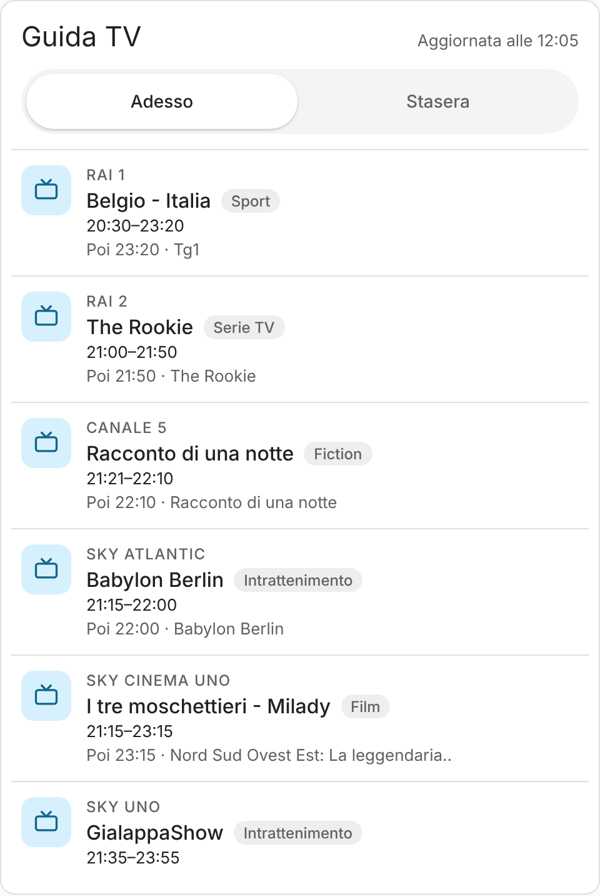
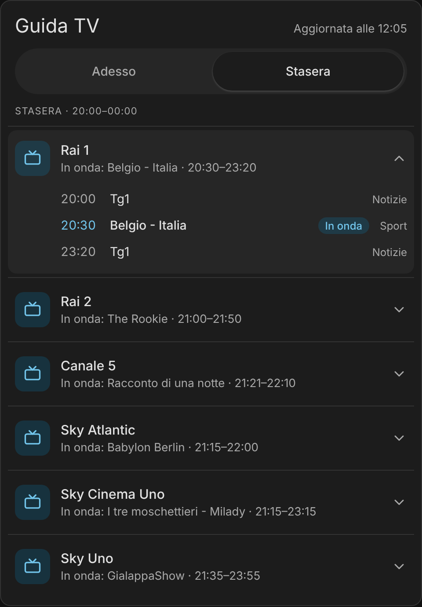

# On Air Card

Lovelace card for the [On Air](https://github.com/ivp-arch/ha-on-air) integration: what is on Italian TV **now** and **tonight**, one row per channel.

| Now (light theme) | Tonight (dark theme) |
|---|---|
|  |  |

- **Adesso (now):** for each channel the programme on air, its category and time, and what comes next.
- **Stasera (tonight):** the evening window (default 20:00–00:00); open a channel to see its whole evening, with the programme on air marked.
- Follows the Home Assistant theme (light and dark). No channel logos, no external fonts or resources.
- The card shows only what the integration provides (attribute contract v1); it computes nothing itself. The interface is in Italian.

## Requirements

The [On Air](https://github.com/ivp-arch/ha-on-air) integration, version 0.1.0 or later, with at least one channel.

## Installation

1. Copy `dist/on-air-card.js` into the `www` folder of your Home Assistant configuration (create it if missing, then restart Home Assistant).
2. Settings → Dashboards → ⋮ → Resources → Add resource: URL `/local/on-air-card.js?v=0.1.0`, type *JavaScript module*. The Resources menu needs Advanced mode in your user profile. Change `?v=` at every update so browsers load the new file.
3. Edit a dashboard → Add card → **On Air Card**.

## Options

| Option | Default | Meaning |
|---|---|---|
| `title` | `Guida TV` | Card title |
| `entities` | all On Air channels | Channel sensors to show, in this order. Empty or missing: every On Air sensor, sorted by channel name |
| `view` | `now` | View shown first: `now` or `tonight` |
| `show_category` | `true` | Show the programme category |

All options are available in the visual editor.

```yaml
type: custom:on-air-card
title: Stasera in TV
view: tonight
entities:
  - sensor.on_air_rai_1
  - sensor.on_air_canale_5
  - sensor.on_air_sky_cinema_uno
```

## Theming

Colours come from CSS variables that default to the Home Assistant theme and can be overridden from a theme or card-mod: `--oa-bg`, `--oa-text`, `--oa-muted`, `--oa-divider`, `--oa-accent`.

## Accessibility

Real buttons for every control, `aria-pressed` on the view switch, `aria-expanded`/`aria-controls` on the channels of the tonight view, 44 px touch targets, visible keyboard focus, text contrast of at least 4.5:1 measured in the default light and dark themes.

## Development

```bash
npm install
npx playwright install chromium   # once
npm test
```

The card has no build step: `dist/on-air-card.js` is the source. `package.json` only holds the test tooling. See [CLAUDE.md](CLAUDE.md).

## License

MIT
